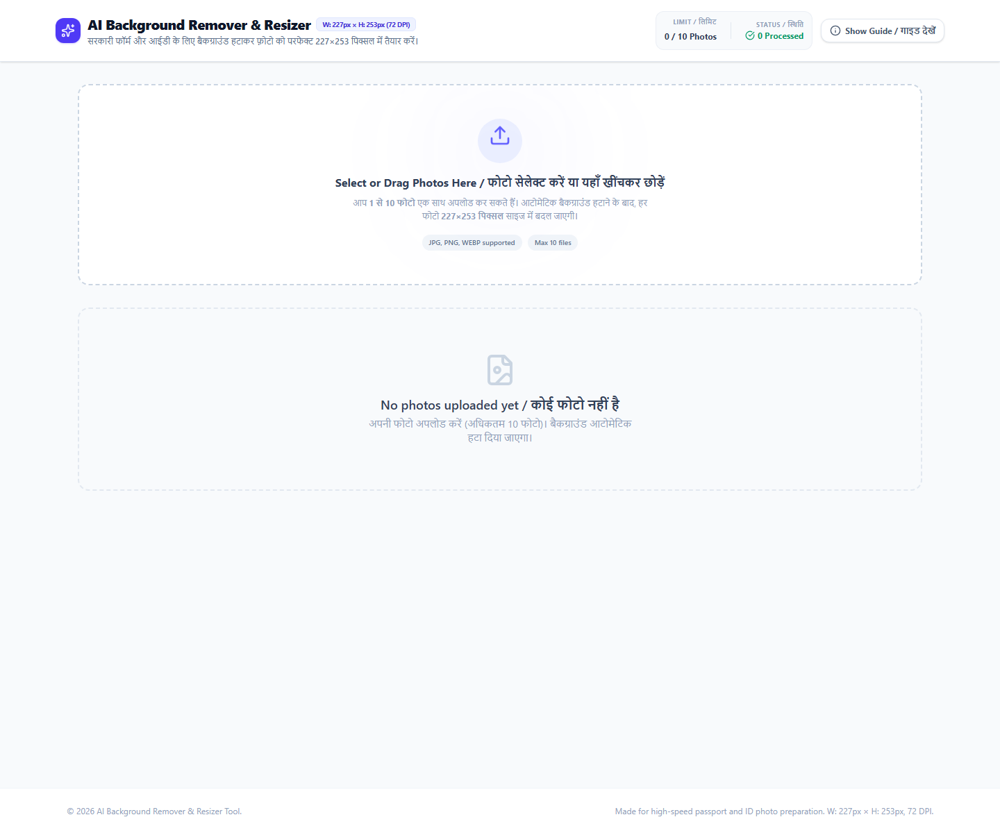
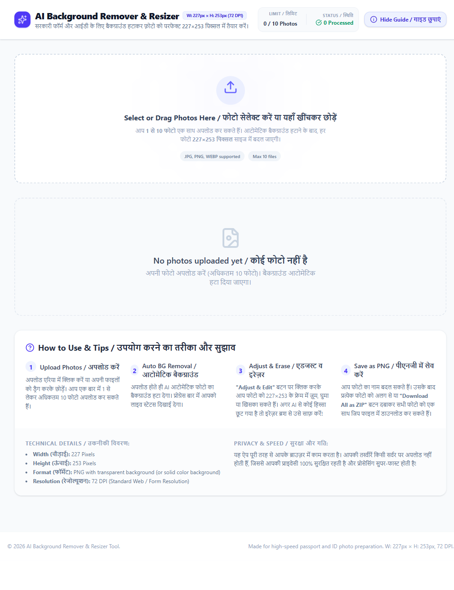

# BG Remover — AI Background Remover & 227×253 Resizer

A web + Windows desktop app that removes image backgrounds in the browser using client-side AI, lets you adjust/crop the result, and exports passport/ID-ready **227×253 px PNG** images. Supports batch processing (up to 10 photos), per-image rename/edit, and **Download All as ZIP**.

## Features
- **AI background removal (client-side)** via `@imgly/background-removal` — no image upload to your server for the core removal flow.
- **Batch upload**: up to **10 photos** at a time.
- **Progress UI**: model download/load/segmentation status per image.
- **Fixed output size**: renders final images at **227 × 253 px** (PNG), suitable for ID/passport-style preparation workflows.
- **Adjustments**: zoom, X/Y position, rotation, background color (including transparent), eraser mask/manual cleanup.
- **Export**: download single PNG, rename output files, download all completed images as a ZIP.
- **Fallback mode**: if AI removal is unavailable in the browser/runtime, the app can fall back to manual crop/adjust using the original image.
- **Desktop app**: Electron wrapper for Windows (portable `.exe` + NSIS installer build config).

## Screenshots
> Generated from a local production build (`vite preview`) via Playwright.

| Home / Upload | Help / Info |
|---|---|
|  |  |

## Tech Stack
- React 19 + TypeScript
- Vite
- Tailwind CSS v4
- `@imgly/background-removal` (AI background removal)
- JSZip (ZIP export)
- Electron + electron-builder (Windows desktop packaging)

## Project Structure
```text
BG-REMOVER-main/
  src/
    App.tsx                 # main app flow/state
    components/             # UI (upload, grid, adjuster, header, help)
    utils/imageHelper.ts    # render final 227x253 PNG, downloads, ZIP
    types.ts                # ImageItem / settings types
  electron/
    main.cjs                # Electron main process
    preload.cjs             # preload bridge
  docs/screenshots/         # README screenshots
  DESKTOP-BUILD.md          # desktop build notes
  INSTALLATION.md           # detailed installation/troubleshooting
  package.json
  vite.config.ts            # base: './' for Electron/file loading
```

## Requirements
- **Node.js** (tested with Node 24.x) and **npm** (tested with npm 11.x)
- Windows recommended for the packaged desktop build steps below (Electron builder config targets Windows x64)
- Internet access on first AI run may be required for model assets (client-side)

## Installation
```powershell
cd BG-REMOVER-main
npm install
```

If you only need the web app:
```powershell
npm run dev
```
Open the URL shown by Vite (configured for port 3000).

For detailed setup/troubleshooting, see [`INSTALLATION.md`](INSTALLATION.md).

## Usage (Web)
1. Start the app (`npm run dev`) or serve a production build (`npm run build && npm run preview`).
2. Upload up to 10 images.
3. Wait for AI processing (progress shown per image).
4. Use **Edit/Adjust** to fine-tune zoom/position/rotation/background/eraser.
5. Rename files if needed.
6. Download a single PNG or **Download All ZIP**.

## Desktop App (Windows)
### Test desktop shell (after install/build)
```powershell
cd BG-REMOVER-main
npm install
npm run desktop:dev
```
`desktop:dev` runs `vite build` and launches Electron against `dist/`.

### Build Windows executables
```powershell
cd BG-REMOVER-main
npm install
npm run desktop:build
```
Artifacts are written to `BG-REMOVER-main/release/`:
- Portable `.exe` (x64)
- NSIS installer (x64)

See [`DESKTOP-BUILD.md`](DESKTOP-BUILD.md) for notes.

## Working Demo / Verification
- **Production build verified locally**: `npm run build` completed successfully in this workspace (Vite build produced `dist/`).
- **UI smoke-verified**: local preview served and screenshots captured via Playwright (`docs/screenshots/home.png`, `docs/screenshots/help.png`).
- **Desktop packaging prepared**: Electron main/preload + electron-builder config added. Actual `.exe` generation requires running `npm run desktop:build` on a machine that can download Electron/electron-builder binaries and complete Windows packaging.

### Quick demo commands
```powershell
cd BG-REMOVER-main
npm install
npm run build
npm run preview
```
Then open the preview URL and upload an image to confirm background removal + 227×253 export.

## Configuration
- `.env.example` exists (AI Studio template). Set environment values in `.env.local` only if your workflow/integration requires them.
- Vite `base` is set to `./` so the same build works in Electron file loading.

## Notes / Limitations
- AI background removal depends on browser/runtime support (WebAssembly/model assets). The app includes a manual fallback path in `src/App.tsx`.
- Processing is client-side; performance depends on device CPU/GPU/browser.
- Output size is fixed to **227×253 px** by design (see `src/utils/imageHelper.ts`).

## License
No license file was present in the original project folder. Add a `LICENSE` file if you plan to distribute this project.
